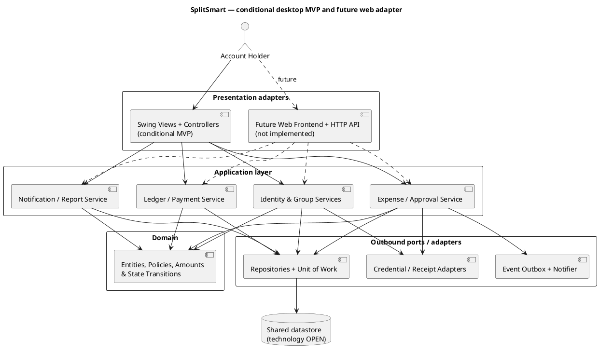

# SplitSmart — Architecture (ChatGPT review draft)

**Date:** 2026-11-04  
**Provenance:** ChatGPT-authored provisional reference, **NOT** Spec Kit or Claude Code output.  
**Approval status:** DRAFT / HUMAN REVIEW REQUIRED  
**Inputs:** `UserRequirement.md`, `.specify/memory/constitution.md`, `specs/001-splitsmart-core/spec.md`.  
**Canonical agent paths reserved:** `speckit/Architecture.md` and `claude/Architecture.md`.

## 1. Purpose, scope, and unresolved platform choice

SplitSmart tracks shared expenses for individuals and groups, supports equal/percentage allocation, approval before accounting effect, expense notifications, pairwise balances, recorded payments, and filtered reports. The customer explicitly specified a **primarily web-based** platform (NFR-001). The 2026-10-28 project constitution instead selects **Java 21 + Maven + Swing** for a desktop MVP. This document describes a **conditional Swing adapter** and an application core adaptable to a future web API, **not** a resolved product-owner decision. **BLOCKER OQ-001:** customer approval is required before treating Swing as an acceptable interim product scope.

### Architectural drivers

- FR-001 and NFR-002: private account data, group role permissions, authenticated access, password recovery.
- FR-002: active group member eligibility; preserve historical membership snapshots.
- FR-003: payer may be excluded from participant set; complete share allocation; optional private receipt.
- FR-004: event-triggered notifications only to eligible group members, with duplication resistance.
- FR-005: configurable approval; no accounting entry before the final required approval.
- FR-006 and NFR-003: consistent pairwise debt/credit balances, `BigDecimal` monetary values and exact reconciliation.
- FR-007: same-recipient credit when paying more than owed.
- FR-008: authorized reports with inclusive date filters.
- FR-009 (spec extension): immutable audit history and reversible/corrective operations rather than destructive edits.

## 2. Logical architecture

**Recommended style:** modular layered / ports-and-adapters architecture. Dependencies flow inward: UI depends on application services, application depends on domain types and port interfaces, adapters implement ports. Domain never imports Swing, SQL APIs, or transport types.

### Component contracts

| Component | Responsibilities | Must not do |
|---|---|---|
| Swing UI | Render forms, navigation, status, client validation and accessible feedback | Own balances, decisions or persistence |
| Identity & Group Services | Account/session boundaries, role checks, membership lifecycle | Expose group data to outsiders |
| Expense Service | Validate amount/splits/participants, submit expense, store approval workflow | Mutate balances for pending/rejected expenses |
| Approval Service | Authorized decisions, approval threshold, once-only approved transition | Duplicate ledger posting |
| Ledger & Payment | Post immutable obligations/payment/credit events, compute pairwise net position | Use floating point or lose audit history |
| Notification | Notify eligible recipients; deduplicate per event and recipient | Send receipts/amounts to unauthorized users |
| Reporting | Authorized read models, inclusive dates, zero-state summaries | Infer balances from unapproved expenses |
| Ports & adapters | Transactional repositories, credential verification, receipt access, event delivery | Leak implementation details into domain |

## 3. Data and transaction boundaries

Suggested domain aggregates: `UserAccount`, `Group`, `GroupMembership`, `Expense`, `Allocation`, `ApprovalDecision`, `LedgerEntry`, `Payment`, `Credit`, `Notification`, and receipt metadata. Store decimals with declared currency and precise scale (policy **OPEN**) and avoid binary floats. A stable idempotency key applies to expense submission, expense approval finalization, and payment recording.

**Atomic approval boundary:** lock/read the expense plus approval status; check actor role and required approvals; apply the final status transition; insert balanced ledger entries exactly once; append audit and notification-outbox events; commit together. Unique constraints for a posted expense ID and idempotency keys block duplicate effects. Pending/rejected entries remain financial no-ops.

**Atomic payment boundary:** validate actor, parties and amount; use a single transaction to create immutable payment, reduce payer-to-recipient obligation to zero if applicable, and allocate excess as payer credit against the **same** recipient. Record a payment idempotency key to protect retries. For distributed or eventual delivery, reporting may lag, but authoritative ledger writes must be consistent.

### Storage strategy — not yet approved

- **Option A: relational DB** (e.g. PostgreSQL server): best for shared multi-user access, transactions, unique constraints, account isolation and migrations; entails running server infrastructure.
- **Option B: SQLite** for isolated classroom demonstrations: low operational complexity and transactional local file; separate desktop clients do **not** automatically share state and concurrent multi-user deployment requires a service/API. It cannot be assumed to meet multi-user customer scope merely because it persists locally.

**Provisional choice:** use a repository interface and design migration-ready relational schema, with storage provider selected by human review. For an actually shared group app, centrally hosted service + relational database is strongly preferred over independent local files.

## 4. Identity, authorization and privacy

Default deny. Require identity for personal/group actions; group role/membership check at service boundary, not only UI. Group managers change membership, configured approvers decide expenses, and only active members may be selected for new expenses. Members removed later retain a historical record but cannot access new group data unless policy permits. Password credentials must be hashed with a reputable adaptive password hasher through a tested identity component, never stored in plain text. Recoveries must use expiring single-use tokens and avoid account enumeration; detailed policy OQ-002 remains OPEN. Signed-in sessions require logout and expiration behavior.

Receipts should be retrieved through authenticated, group/expense-scoped access; never place public raw receipt URLs in notifications. Authorization applies equally to report exports and API endpoints.

## 5. Operational behavior and integration

- **Notification:** emit ExpenseCreated once; a reliable outbox + uniqueness on (eventId, recipientId, channel) prevents duplicate sends when workers retry. In-app inbox is a proposed baseline; email/external delivery remains OQ-006.
- **Report:** read approved ledger postings and payments only for financial totals; include pending/rejected status separately as non-financial information where authorized. Date ranges inclusive on the chosen business date and timezone policy (OPEN).
- **Corrections:** use explicit cancel/reversal ledger events rather than deleting expense/payment history. Membership, approver decisions, and notification deliveries remain traceable.
- **Observability:** sanitized structured logs with correlation IDs; avoid credentials, raw receipt contents, and private financial data in logs.

## 6. Architectural decisions and risks

| ID | Decision / issue | Status | Consequence |
|---|---|---|---|
| ADR-001 | Java 21, Maven, JUnit 5, PlantUML, OO isolation | Governance baseline | Required for any approved MVP |
| ADR-002 | Swing desktop MVP versus web-first customer request | **BLOCKED — OQ-001** | Must not claim full platform compliance |
| ADR-003 | BigDecimal, atomic ledger and idempotent approval | Required design invariant | Protects money correctness |
| ADR-004 | Centrally hosted relational storage for true multi-user mode | PROPOSED | Requires deployment choice and persistence approval |
| ADR-005 | In-app notifications with eventual delivery | PROPOSED — OQ-006 | May need external channel |
| ADR-006 | Currency/scale/residue algorithm | OPEN — OQ-004 | Affects reproducible balances |
| ADR-007 | Approval depth/self-approval policy | OPEN — OQ-003 | Affects authorization and state machine |
| ADR-008 | Record/receipt retention and deletion | OPEN — OQ-007 | Affects audit/privacy obligations |

**High risks:** platform variance; a local Swing app that falsely appears to support group synchronization; approval race and duplicate posting; weak authorization around receipts; arbitrary cent residue allocation. Each must have a test and human review gate before implementation claims.

## 7. Requirement mapping and verification strategy

| Requirement | Architecture owner / verification focus |
|---|---|
| FR-001 | Identity service; login, logout, recovery, unauthorized reads |
| FR-002 | Group service; membership authorization, history |
| FR-003 | Expense service; validation, allocations, receipt access |
| FR-004 | Outbox/notification; only eligible members, idempotency |
| FR-005 | Approval service; thresholds, rejection, exactly-once posting |
| FR-006 | Ledger; pairwise reconciliation and zero-state |
| FR-007 | Payment service; normal settlement, same-recipient credit |
| FR-008 | Reporting; filters, privacy, totals |
| FR-009 | Audit event history and explicit corrections |
| NFR-001 | Product-owner gate for web-versus-Swing |
| NFR-002 | Default-deny service authorization |
| NFR-003 | BigDecimal reconciliation/invariant tests |
| NFR-004..006 | Usability/latency, error clarity, durable retention decisions |

**Testing direction:** JUnit 5 unit tests for the domain with fake ports; integration tests for transaction and repository behaviors; UI smoke tests separate from financial rules; UML source must be reviewed against resulting code. No tests or code have been executed in preparing this document.
