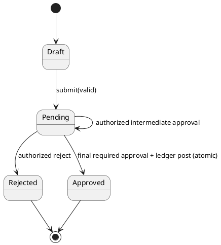
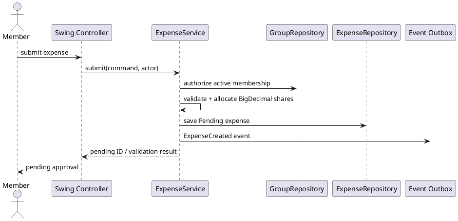
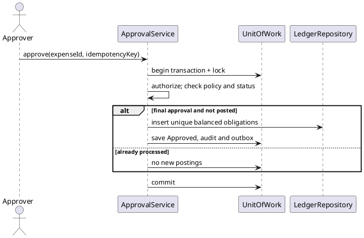

# SplitSmart — Detailed Design (ChatGPT review draft)

**Date:** 2026-11-04  
**Provenance:** ChatGPT proposal; **NOT** an actual Spec Kit or Claude Code output.  
**Status:** DRAFT / HUMAN REVIEW REQUIRED; platform and remaining policy decisions unresolved.

## 1. Source-of-truth and class responsibilities

Authoritative references: `UserRequirement.md`, `.specify/memory/constitution.md`, `specs/001-splitsmart-core/spec.md`. User stories and settled clarify answers already exist in `spec.md`. Keep Java Swing only in presentation; Java 21/Maven, BigDecimal, JUnit 5, PlantUML govern the conditional MVP. No domain code imports javax.swing.

| Type/service | Representative fields/operations | Invariant |
|---|---|---|
| UserAccount | ID, email, credential hash reference, status | Identity/authorization |
| Group | ID, name, settings, approvalPolicy | Named membership boundary |
| GroupMembership | userId, groupId, role, active interval | Only active members join new expenses |
| Expense | ID, groupId, payerId, date, description, Money, splitMode, state, receiptRef | Positive amount and valid participants |
| ExpenseAllocation | expenseId, participantId, Money | Sum(all allocations) = expense amount |
| ApprovalDecision | expenseId, reviewerId, level, decision, timestamp | Reviewer authorized; decisions audited |
| LedgerEntry | ID, expense/payment source, fromUser, toUser, amount, currency, timestamp | Immutable, deduplicated financial events |
| Payment | ID, fromUser, toUser, amount, date, idempotencyKey | Accepted once |
| Credit | fromUser, toUser, unusedAmount, sourcePayment | Unused overpayment is pair-specific |
| Notification | eventId, recipient, channel, read/delivery status | Eligible recipient, deduplicated |
| ExpenseService | submit/validate/allocate | No posting during submission |
| ApprovalService | approve/reject with transaction | One final posting after approval |
| BalanceService | balancesByCounterparty, reconcile | Approved transactions + payments only |
| PaymentService | recordPayment | Settlement plus overpayment credit |
| ReportService | report(period, group, status) | Authorization and filters |
| Ports | Repository, UnitOfWork, Authentication, ReceiptStore, Notifier | Adapters swappable |

## 2. Financial model and examples

Use `Money(BigDecimal amount, Currency currency)`; no `double` or `float` anywhere in monetary calculations or persistence. **Policy pending (OQ-004):** currency, precision, and remainder ordering. For illustrations only, assume USD with scale 2 and HALF_UP; this is a **PROPOSED** assumption, not approved product policy.

**Equal split:** calculate the smallest currency units, floor baseline per participant, and assign remaining units deterministically (e.g. ascending participant ID). This avoids unreconciled cents. Example $10.00 / 3 => $3.34, $3.33, $3.33. The exact recipient of the extra cent remains unapproved.

**Percentage split:** validate nonnegative percentages and exact total = 100 using decimal arithmetic; multiply total by percentage/100; round HALF_UP to currency scale, then distribute any signed cent difference deterministically so the total equals original. E.g. $0.05 at 50%/50% starts $0.03+$0.03 after HALF_UP; reduce one designated participant by $0.01 to produce $0.03+$0.02. Never leave a negative allocation; for tiny amounts ensure policy handles more participants than currency units. Remainder assignment must be stable and recorded.

**Payer included:** A pays $60 for A, B, C equally. Allocations A=$20, B=$20, C=$20. Post obligations B->A $20 and C->A $20; never A->A. A payer outside participant set is allowed so long as the payer is a valid active group member; all selected participants must be active group members.

**Overpayment:** B pays A $25 against a $20 debt. B->A debt becomes $0 and B has $5 credit **against A**, not against another group member. The payment remains $25 in payment history. When a future expense creates B->A debt, apply that existing pair credit according to a documented offset rule. A pairwise net-position ledger is an alternative representation; ensure credit is visible and not silently discarded.

**Accounting model caution:** Expenses and payments across different groups or currencies must not be silently netted; identify the account/group/currency dimension and decide whether balance presentation is group-specific or global. This is an additional policy decision for human review.

## 3. Expense and approval state model



Transitions are immutable audit events. Repeated approvals on an already approved expense return its existing result, not another posting. Group approval configuration is captured/snapshotted at submission or otherwise versioned; later group setting changes must not retroactively alter decisions. The exact number/roles of reviewers and self-approval are OPEN (OQ-003).

## 4. Command and persistence design

Illustrative application port signatures (interface-level design only):

```java
interface ExpenseCommands {
    ExpenseId submitExpense(SubmitExpenseCommand command, Actor actor);
}
interface ApprovalCommands {
    ApprovalOutcome decide(ExpenseId id, ApprovalDecisionCommand command, Actor actor);
}
interface PaymentCommands {
    PaymentReceipt recordPayment(RecordPaymentCommand command, Actor actor);
}
interface BalanceQueries {
    PairwiseBalance balance(GroupId group, UserId debtor, UserId creditor, Currency currency, Actor actor);
}
interface ReportQueries {
    ExpenseReport generate(ReportFilter filter, Actor actor);
}
```

Each command has a caller-generated idempotency key. Write units of work run in ACID transactions. Suggested relational uniqueness: unique expense posting by `expense_id`; unique payment by `idempotency_key` scoped to actor; unique approval decision by `expense_id, level, reviewer_id` as appropriate; unique delivery by `event_id, recipient_id, channel`. Exact table implementation is pending technology choice.

**Expense write:** authenticate -> authorize active membership -> validate payer/participants -> validate positive amount/date/description -> compute immutable allocations -> save Pending -> append ExpenseCreated outbox event -> commit; no ledger effect.

**Final approval write:** authenticate approver -> lock expense -> evaluate stored policy -> reject or record approval -> if final, transition to Approved and insert one ledger entry per non-self allocation -> save audit/outbox -> commit. Retry sees approved state and returns original outcome.

**Payment write:** authenticate -> authorize payer and target pair -> validate amount/currency -> transactionally read outstanding pair debt/credit -> apply payment -> create credit for excess -> record audit/outbox -> commit. Repeat by key returns original receipt without new financial event.

## 5. Sequence designs





## 6. Authorization matrix (proposed minimum)

| Action | Authenticated account | Active member | Manager | Configured approver |
|---|---|---|---|---|
| Read own personal summary | Yes | N/A | N/A | N/A |
| Create group | Yes | N/A | N/A | N/A |
| Edit group membership | Yes | Yes | Yes | N/A |
| Submit group expense | Yes | Yes | N/A | N/A |
| Access group receipt | Yes | Yes + expense access | N/A | N/A |
| Approve expense | Yes | Yes | Policy-dependent | Yes |
| Record payment | Yes | Valid pair/party | N/A | N/A |
| Generate group report | Yes | Yes | May broaden allowed view | N/A |

Final policies for payment recording and approval are not yet approved; do not treat this matrix as an adopted access-control policy.

## 7. Verification / test matrix (planned only)

| Tests (JUnit 5 identifiers) | Verifies |
|---|---|
| `AuthServiceTest.signInAndIsolateAccounts` | FR-001, NFR-002 |
| `GroupServiceTest.removeMemberPreservesHistory` | FR-002, FR-009 |
| `ExpenseAllocationTest.equalSplitWithRemainder` | FR-003, NFR-003 |
| `ExpenseAllocationTest.percentSplitExactly100` | FR-003 |
| `ExpenseServiceTest.rejectNonGroupParticipant` | FR-002, FR-003 |
| `ExpenseServiceTest.payerMayBeExcludedFromShares` | Clarify decision 1 |
| `NotificationTest.deliverOnlyToEligibleMembers` | FR-004 |
| `ApprovalServiceTest.pendingAndRejectedDoNotPost` | FR-005 |
| `ApprovalConcurrencyTest.repeatedFinalApprovalPostsOnce` | FR-005, FR-006 |
| `BalanceServiceTest.reconcilePairwiseLedger` | FR-006, NFR-003 |
| `PaymentServiceTest.overpaymentCreatesPairCredit` | FR-007 |
| `PaymentServiceTest.duplicatePaymentKeyPostsOnce` | FR-007 |
| `ReportServiceTest.inclusiveDateRangeAndPrivateScope` | FR-008, NFR-002 |
| `AuditTest.expenseCorrectionsPreserveHistory` | FR-009 |
| `PlatformReviewTest.requireApprovedVarianceDocument` | NFR-001 (review gate, not executable unit test) |

No Maven build, Java source compilation, or JUnit tests were performed.

## 8. Clarification gates before implementing

- **BLOCKING OQ-001:** Do stakeholders accept a Swing desktop MVP as an interim deviation from primary web-based delivery? If not, revise platform decision/constitution with approval.
- **OPEN OQ-002:** Password policy, secure recovery and session lifetime.
- **OPEN OQ-003:** Who approves, who can self-approve, required levels and conflict-of-interest rules.
- **OPEN OQ-004:** Currency scale and deterministic split residue allocation.
- **OPEN OQ-006:** In-app versus email/external notifications and retry limits.
- **OPEN OQ-007:** Data and receipt retention, deletion and audit preservation.
- **ADDITIONAL OPEN:** authoritative group-versus-global balance scope, multiple currencies and cross-group credit offset behavior; storage and synchronization deployment topology.

**Recommendation:** use this draft to test the two independently generated alternatives, not as their substitute. Do not implement or merge as final without human approval.
